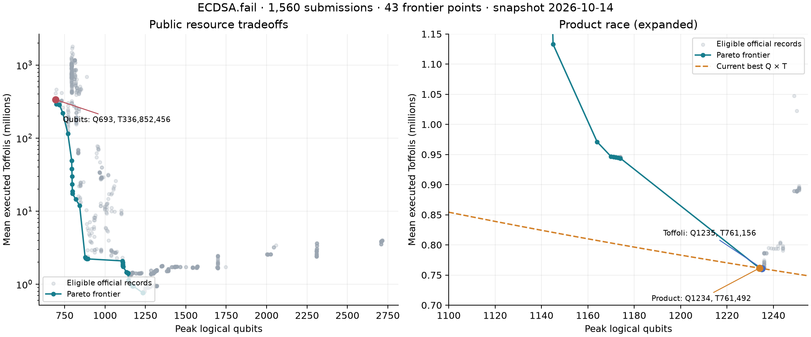
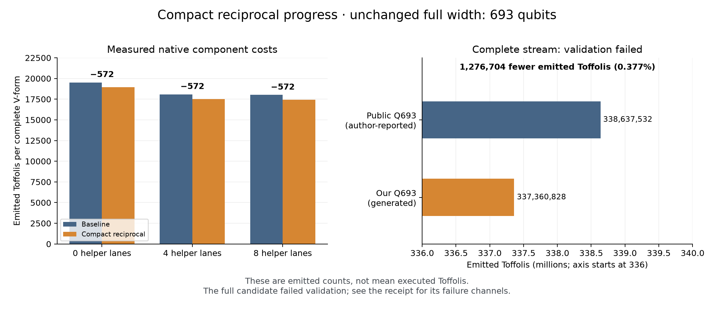

# ECDSA Circuit Optimization

**Building smaller, cheaper reversible arithmetic for secp256k1.**

This project studies the quantum circuit at the heart of the
[ECDSA.fail challenge](https://ecdsa.fail/): adding an elliptic-curve point to
another point. Our aim is to advance three resource records—**logical qubits**,
**Toffoli gates**, and their **product**—through reproducible circuit design,
mathematical proofs and measured experiments.

> **Research status · 14 October 2026:** the earlier public product baseline has
> been reproduced successfully. Our compact reciprocal passes component and
> integration checks, and its complete Q693 circuit has been generated. However,
> the full 9,024-shot benchmark **failed validation**: 6 classical mismatches,
> 3 phase-garbage batches and 6 ancilla-garbage batches. **There is no qualified
> new score or submission. The server evaluation has finished.**

[Objectives](#our-three-objectives) · [Public frontier](#where-the-public-frontier-stands) ·
[Results](#what-we-have-demonstrated) · [Server run](#what-ran-on-the-server) ·
[Next steps](#next-steps) · [Reproduce](#explore-and-reproduce)

## Why point addition matters

ECDSA is a digital-signature scheme used in many systems, including
cryptocurrencies. A sufficiently capable fault-tolerant quantum computer could
use Shor's algorithm to solve the underlying elliptic-curve discrete-logarithm
problem. That algorithm repeatedly performs elliptic-curve arithmetic, so making
one of its central operations cheaper can reduce the resources of the larger
computation.

Our circuit implements the in-place operation **`P → P + A`**, where `P` is a
quantum point and `A` is a classically supplied point on secp256k1. It must retain
quantum coherence, return temporary storage to its initial state and avoid
unwanted relative phase. Ordinary classical arithmetic that gives the right
number is not sufficient.

We build and simulate these circuits on ordinary computers. This repository
contains a point-addition research kernel; it does not implement a complete
private-key recovery system or require physical quantum hardware.

## Our three objectives

| Resource | Plain-language meaning | Goal |
|---|---|---|
| **Q: peak logical qubits** | The largest amount of quantum storage used at once | Use fewer qubits |
| **T: mean executed Toffolis** | The average number of costly three-bit reversible gates executed per input | Use fewer expensive gates |
| **Q × T** | The challenge's score, balancing storage and gate cost | Minimize the product |

A logical qubit is an error-corrected computational resource, not one physical
qubit. The scorer uses rounded **mean executed** Toffolis, including conditional
execution; this differs from the number of Toffolis written into a circuit.

The smallest circuit and the cheapest circuit can be different designs. We
therefore maintain separate qubit, Toffoli and product tracks. The platform
promotes the best scalar product; its Pareto frontier also exposes useful
tradeoffs between width and gate count.

## Where the public frontier stands



*Left: the storage/gate tradeoff, with a logarithmic gate axis. Right: an expanded
view near the product leaders. Lower and further left is better. The dashed
line marks the current best product; different points lead different metrics.*

Latest snapshot: **1,560 submissions, 1,219 eligible official records and 43
Pareto points**, refreshed on 14 October 2026.

| Objective | Current public record | Our strict target |
|---|---:|---:|
| Minimum qubits | **693**, at T336,852,456 | **Q ≤ 692** |
| Minimum Toffolis | **761,156**, at Q1235 | **T ≤ 761,155** |
| Minimum product | **939,681,128**, at Q1234/T761,492 | **Q × T ≤ 939,681,127** |

At Q1234, a product improvement now needs T ≤ **761,491**. At Q1235 it needs
T ≤ **760,875**. These targets change as other participants improve the record.
The new product record supersedes the Q1234/T761,658 circuit we reproduced.

Sources: [full frontier](docs/frontier-results.md),
[dated data and source revisions](docs/data/latest-leaderboard.json), and
[public submission records](https://api.ecdsa.fail/api/benchmarks/1ffb695a-309b-46b6-a728-2f97d8c7be74/submissions).
Failed or claimed-only results are excluded; explicit score-only rejections
with consistent official metrics are included.

## What we have demonstrated

### 1. A reproducible starting point

We ran the unchanged challenge benchmark on public revision `c5bb1ec8`:
**Q1234 / T761,658 / product939,885,972**. All **9,024 shots** passed, with zero
classical mismatches, phase-garbage batches or ancilla-garbage batches. The
generated stream hash matches the earlier recorded reproduction.

This validates our environment and ability to reproduce that published circuit.
It is a reproduction of the **previous** product record, not our own improvement
or a new platform evaluation. [Verification receipt](docs/data/server-verification.json)

### 2. A compact reciprocal with measured savings

The low-qubit circuit repeatedly computes a reciprocal to estimate division
decisions. The existing implementation uses 25 remainder lanes. Our version
uses **24 lanes**, retaining the same precision, by temporarily storing overflow
in the existing quotient flag and treating the divisor's known leading bit as a
constant.

The change frees one lane **inside this subroutine**. It does not yet reduce the
complete circuit's peak width: other operations still need **693 qubits**.



*The full-stream panel has an explicitly truncated axis to show a small change.
Both panels show emitted counts, not the challenge's mean executed metric. The
full baseline count comes from its public author's report; our candidate and
component counts come from preserved server logs.*

| Check or measurement | Result | What it establishes |
|---|---:|---|
| Restoring-division arithmetic identity | Solver checks pass at widths 2–8, 16 and 24 | The identity within its stated divisor/remainder domain |
| Small virtual-bit comparator | **43,688 exhaustive cases** | Values and inverse behavior at tested small widths |
| Small restoring step | **16,383 exhaustive cases** | Correct updates for all tested normalized odd divisors and remainders |
| Native reciprocal fixtures | **1,536 cases**, **1,089,536 measurement-phase coefficients** | Tested value, inverse, scratch and phase behavior |
| Focused component suite | **17 passed**, one existing test ignored | Component regression |
| Complete column fixture | **203 columns × 64 varied payloads**, zero phase | Integration on that fixed traversal with varied payloads |
| Complete generated circuit | **693 qubits**, **337,360,828 emitted Toffolis** | A generated candidate with lower emitted cost |
| Full 9,024-shot benchmark | **Failed:** 6 classical mismatches, 3 phase batches, 6 ancilla batches | No qualified score; failure diagnosis is next |

The generated full stream contains **1,276,704 fewer emitted Toffolis** than the
public Q693 source's reported 338,637,532—a **0.377%** reduction. The native
V-form fixtures save **572 emitted Toffolis per call**. Neither number is a
qualified mean-executed improvement: the full candidate failed validation.

Finite fixtures and a domain-specific arithmetic proof do not prove the complete
point-addition circuit correct for every input. The broader regression run also
hit a memory limit; we do not report it as passing. The column fixture passed
after provisioning enough memory.

Source and evidence: [experiment patch](experiments/qubits/compact-reciprocal.patch),
[source manifest](experiments/qubits/manifest.json),
[experiment receipt](docs/data/qubit-experiment.json), and
[detailed research notes](docs/research-plan.md).

### 3. A clearer gate-optimization target

We checked the existing small forward/reverse correction networks on all 78
inputs in their specified signed domain. Their **14 and 12 AND gates already
meet the lower bounds for their fixed inputs and outputs** in the XOR/AND model.
Resynthesizing those isolated interfaces cannot reduce their AND counts.

We then extracted the surrounding forward construction over **all 16,384 raw
inputs**. Its value interface has a 25-AND lower bound, while the current unshed
construction uses 31 forward ANDs. The gap motivates joint synthesis across
construction and correction. It is a research opportunity, not a demonstrated
six-gate saving: cleanup, phase repair and live storage must also fit.
[Source-bound analysis](docs/data/fold-core-analysis.json)

## What ran on the server?

One full evaluation of the **compact-reciprocal Q693 candidate** ran in
`/home/hclau/ecdsa_research` on `smu_server`. Compilation, focused tests and circuit
generation succeeded. **`eval_circuit` then checked all 9,024 hash-derived
inputs and measured executed gate counts**, using the unchanged scorer.

The stream contains **1,128,046,998 operations**. The benchmark took **38 minutes
17.5 seconds**, used roughly one CPU core, and peaked at **59.7 GiB RAM**. It
evaluates batches sequentially; the large stream explains the cost relative to
the Q1234 baseline replay.

The run finished with exit status **1** and no valid `score.json`. The first
reported classical mismatch was **shot 1170**. Both ECDSA job processes have
exited; **no ECDSA evaluation remains running** at the latest inspection. The
cause is not yet localized: the available evidence does not tell us whether the
failure is inherited from the approximate base or introduced by our change.

The job was launched with **`nohup`**, redirected input/output, a dedicated log
and a saved PID. Both parent and scorer were checked to ignore SSH hangups.
Long-running server jobs will continue to use this pattern:

```bash
cd /home/hclau/ecdsa_research
nohup bash server-qubits-candidate.sh \
  > logs/qubits-compact-candidate.log 2>&1 < /dev/null &
echo $! > logs/qubits-compact-candidate.pid
```

This is the completed run's documented launch pattern, not a request to rerun
the failed candidate. See [server operations](docs/SERVER_HANDOFF.md) for resource
checks, logs, exit markers and resume instructions. The complete failure log and
stream hash are preserved, and its follow-up monitor is paused after collecting
the result. Other server workloads were left untouched.

## Can we submit it?

**No submit-ready original improvement yet.** We have an implemented candidate
with passing component checks, but its complete circuit failed correctness.
That candidate must be repaired and revalidated before submission. No new
submission has been made.

If a repaired complete run passes and reduces executed Toffolis at Q693, it may improve
the **low-width Pareto point**. It would still use the same minimum width, and
its gate cost would remain far above the global Toffoli and product leaders.
Winning the minimum-qubit objective requires the next Q692 design.

Before submission we require the final source and stream hashes, full benchmark
success, fresh/paired input checks, refreshed public targets, and a write-up
stating both the improvement and its limitations. Only `src/point_add/` belongs
in a contestant submission; the harness, simulator, scorer, reference curve,
dependency manifests and toolchain remain protected.

## Next steps

1. **Localize the full-run failure.** Start with shot 1170 and replay the same
   inputs against the unmodified base, tracking column states, scratch and phase.
   Establish whether the change introduced a defect or preserved a base failure.
2. **Repair and qualify Q693.** Add regression cases for the observed failures,
   prove the relevant caller assumptions, measure savings on common and fresh
   inputs, then rerun the unchanged full benchmark. Prepare a submission package
   only after correctness passes and a resource improvement is measured.
3. **Design Q692.** Prove when shared lanes hold quotient bits, scratch or control
   flags. Resolve the additional quotient owner, accumulator conflicts and
   delayed-crossing padding before reducing the ring size.
4. **Pursue gate and product savings separately.** Synthesize the complete fold
   construction and cleanup together, and study the new product leader before
   rebasing the product experiments. Count the entire replacement's cost.

We prioritize changes with a proved arithmetic basis and measured savings.
We retain failures as evidence and do not search identity-tail nonces to select
a passing test packet. The public circuits include approximations, so passing
one packet must remain distinct from an all-input correctness proof.

## Explore and reproduce

| Location | Contents |
|---|---|
| `agents/qubits/` | Public Q693 base plus our compact-reciprocal working changes |
| `agents/toffoli/` | Public minimum-Toffoli base |
| `agents/product/` | Reproduced `c5bb1ec8` product base; latest public record is tracked in the data |
| `src/point_add/` | Earlier Q1235 implementation and inactive root research |
| `experiments/` | Reapplicable patches and exact source provenance |
| `scripts/` | Analysis, plots, proofs, audits and server helpers |
| `docs/data/`, `docs/figures/` | Compact evidence and generated plots |
| `research-output/` | Ignored raw snapshots, logs and large generated artifacts |

Initialize the public source tracks, then use Python for analysis:

```bash
git submodule update --init --jobs 3
python -m pip install matplotlib==3.11.2 z3-solver==5.1.0.0
python scripts/audit-workspace.py
python scripts/test_leaderboard.py
python scripts/analyze-leaderboard.py --refresh --plot
python scripts/plot-research-progress.py
python scripts/prove-compact-reciprocal.py
python scripts/analyze-fold-core.py
```

Use an isolated Python environment; platform-specific commands are in
[local setup](LOCAL_SETUP.md). Circuit compilation uses pinned **Rust 1.93.0**,
locked dependencies and the Linux benchmark harness. To reproduce our candidate
in a fresh public checkout, follow [the experiment instructions](experiments/qubits/README.md).

Earlier uncommitted helpers and ignored evidence were absent from the transferred
workspace. Their reports are marked historical; see [the recovery audit](docs/data/workspace-audit.json).
The active source includes have been checked. A root Git commit cannot preserve
uncommitted submodule changes, which is why the experiment patch is tracked here.

## Research foundations and credits

This project builds on the public challenge and its contributors' circuits.
Public reproductions are credited to their source revisions; our local changes
are separated in experiment patches.

- [Official challenge source](https://github.com/Layr-Labs/ecdsafail-challenge)
  and [challenge rules](https://ecdsa.fail/terms).
- [Optimized point-addition circuits](https://arxiv.org/html/2606.02235v1):
  Euclidean decision recording, coefficient replay and specialized modular arithmetic.
- [Efficient record-and-replay arithmetic](https://arxiv.org/html/2609.28882v1):
  compressed decisions, ping-pong GCD and fused replay.
- [Space-efficient point addition](https://arxiv.org/html/2607.13816v2):
  register sharing and explicit circuit-level constructions.
- [Temporary logical ANDs](https://arxiv.org/abs/1709.06648) and
  [controlled add/subtract multiplication](https://arxiv.org/html/2410.00899v1).

For experimental assumptions, unsuccessful attempts and proof limits, read
[the research plan](docs/research-plan.md). Licensing and attribution information
is preserved in [NOTICE](NOTICE); this workspace does not replace the upstream
terms or claim ownership of reproduced public designs.
