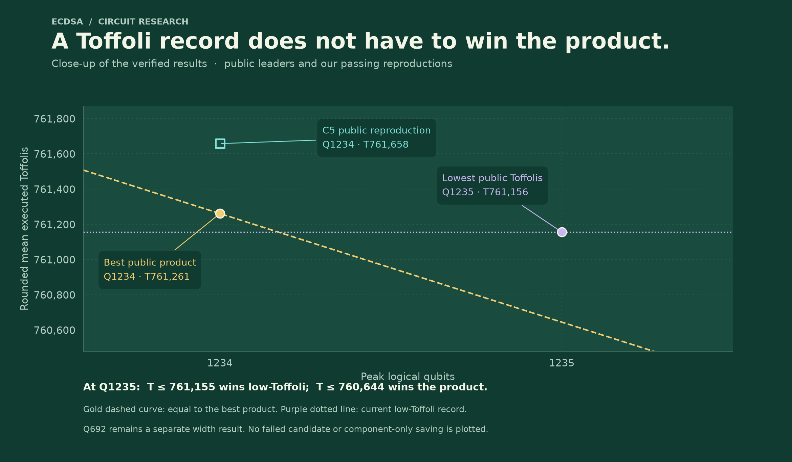

# ECDSA Circuit Research

**Smaller quantum circuits for secp256k1 point addition. Three independent goals:
fewer logical qubits, fewer Toffolis, and a lower qubit × Toffoli product.**

## Where we stand

**15 October 2026 — one new complete local benchmark result: 692 logical qubits.**
The original bank-swap v2 circuit passed all **9,024 shots**, with zero value,
phase or ancilla failures. Its width is one qubit below the public minimum of
693. It is **not an official submission**, and we do not yet have a
submission-ready circuit or a qualified new Toffoli/product record.

The newer Q692 version that fits the normal build is a **different circuit**:
its full benchmark failed correctness. That failure does not invalidate the
preserved original pass, and the original pass does not qualify the new version.
[Current results and submission status](docs/results-status.md) ·
[Original passing result](experiments/followup-20261015/bankswap-terminal/RESULT.md) ·
[Independent verification](experiments/verification-20261015/independent-verification.json)


The gold step is the **officially scored public frontier**. The cyan diamond is
our **separate local Q692 pass**. Leftward means fewer qubits; downward means fewer
Toffolis. The vertical axis is logarithmic. The original Q692 circuit saves width
at a substantial gate-cost increase. Failed and component-only experiments are
excluded from these performance figures.

## Three records, not one

| Objective | Public record | Our result | Next strict target |
|---|---:|---|---:|
| **Minimum logical qubits** | 693 | **692 — complete local pass**, not submitted | Qualify that width for submission |
| **Minimum executed Toffolis** | 761,156 at Q1235 | No new qualified record | T ≤ 761,155 |
| **Minimum Q × T** | 939,396,074 at Q1234/T761,261 | No new qualified record | Q × T ≤ 939,396,073 |

An improvement in **any one** of these objectives matters. The challenge
promotes the scalar product, while its Pareto view also recognizes the low-qubit
and low-Toffoli extremes. A Toffoli record can use more qubits and have a worse
product. These are separate achievements.



At Q1235, **T761,155** would improve the Toffoli record, while **T760,644** or
less is needed to beat the product. At Q1234, the product threshold is
**T761,260**. These thresholds use the refreshed public score, not emitted gates.

Snapshot: **1,564 public submissions · 1,223 eligible scored records ·
45 public Pareto points**, refreshed 15 October 2026.
[Full frontier and provenance](docs/frontier-results.md) ·
[Machine-readable records](docs/data/latest-leaderboard.json) ·
[Public API](https://api.ecdsa.fail/api/benchmarks/1ffb695a-309b-46b6-a728-2f97d8c7be74/submissions)

## Complete passing results

Only complete passing circuit evaluations appear in this table.

| Circuit | Peak Q | Rounded mean executed T | Q × T | Provenance |
|---|---:|---:|---:|---|
| **Our original bank-swap v2** | **692** | **1,481,382,858** | **1,025,116,937,736** | [9,024-shot local pass](experiments/followup-20261015/bankswap-terminal/RESULT.md); streamed generation, unchanged protected evaluator |
| Public C5 reproduction | 1,234 | 761,658 | 939,885,972 | [Complete passing reproduction](docs/data/server-verification.json), source `c5bb1ec8` |
| Public B3 reproduction | 1,235 | 761,156 | 940,027,660 | [Complete passing reproduction](experiments/overnight-20261014/coordinator/b3-reference-full-receipt.json), source `b3c9fdd6` |

**The latter two reproduce other contributors' circuits; they are not our own
record improvements.** Each passed its complete benchmark packet. Independent
inputs also expose inherited arithmetic and phase failures in those baselines.
A finite passing benchmark is not a proof for every valid input.
[Counterexamples](experiments/overnight-20261014/product/b3-paired-results.md)

## What the recent experiments established

- **Width:** the original Q692 pass is preserved with its exact patch,
  stream hash, evaluator hash and score. Ordinary submission generation and
  arithmetic limits remain unresolved for that original version.
- **Submission engineering:** a later Q692 version builds within the tested
  memory budget, but its complete benchmark reports three value failures,
  two phase-failure batches and three ancilla-failure batches. Diagnosis is
  continuing on the same failed inputs.
- **Toffoli reduction:** exact caching rewrites reduce executed gates in paired
  tests, including a wider design that trades extra qubits for a larger saving.
  They retain inherited correctness failures and have no qualified score.
- **Product:** the completed product-focused cycle produced no qualified
  improvement. Exact savings and unsuccessful width searches are preserved.

Detailed counts, test domains and failures:
[current results](docs/results-status.md) ·
[Toffoli experiments](experiments/toffoli-readiness-20261015/REPORT.md) ·
[product experiments](experiments/product-focus-20261015/REPORT.md) ·
[experiment archive](docs/experiment-outcomes.md).

## What we are building

The circuit performs **`P → P + A`** on secp256k1, with a quantum point `P`
and a classically supplied point `A`. It must compute the right coordinates,
clean temporary storage and preserve quantum phase. Correct classical output
alone is insufficient.

This is a building block of quantum elliptic-curve algorithms. We design and
simulate circuits on classical computers; this repository does not implement
a complete private-key recovery system.

**Q** is peak logical storage, not circuit depth or physical qubits.
**T** is rounded mean *executed* Toffolis, including conditional execution.
It is not the number of Toffolis written into the generated stream.

## Next work

1. Preserve the original Q692 result while repairing and qualifying the
   submission-oriented version. Keep their evidence separate.
2. Repair the lower-Toffoli baseline's demonstrated arithmetic/phase failures.
   Retain the exact caching savings, then measure the complete repaired design.
   A higher width is acceptable for a new Toffoli record.
3. Continue product work independently. Include the full cost of scratch,
   cleanup, phase correction and correctness repairs.
4. Evaluate final source with the unchanged benchmark, retain independent
   checks, verify ordinary packaging and compare with fresh public records.

Only `src/point_add/` may change in a contestant submission. We preserve the
harness, scorer, simulator, curve reference, dependencies and toolchain. We do
not search identity-tail nonces or tune hash-derived test packets.
[Research plan](docs/research-plan.md) · [Server workflow](docs/SERVER_HANDOFF.md)

## Reproduce and explore

The figures are static PNGs for reliable GitHub rendering, with downloadable
[frontier SVG](docs/figures/frontier.svg) and
[record comparison SVG](docs/figures/record-tradeoffs.svg).
Their green-and-gold presentation is inspired by the challenge; all points use
this repository's dated evidence.

```bash
git submodule update --init --jobs 3
python -m pip install matplotlib
python scripts/test_leaderboard.py
python scripts/test_frontier_plot.py
python scripts/frontier_plot.py                         # offline, tracked data
python scripts/analyze-leaderboard.py --refresh --plot  # refresh public records
```

Use an isolated Python environment. Circuit builds use pinned Rust 1.93.0 and
locked dependencies. [Local setup](LOCAL_SETUP.md) documents the environment.
Research runs on `smu_server` under `/home/hclau/ecdsa_research`, with resource
preflights, dedicated logs and saved process IDs.

| Location | Contents |
|---|---|
| `agents/qubits/`, `agents/toffoli/`, `agents/product/` | Separate public source tracks and working research |
| `experiments/` | Exact patches, proofs, tests, failures and receipts |
| `docs/data/`, `docs/figures/` | Dated evidence, public records and figures |
| `scripts/` | Reproduction, analysis, plotting and validation tools |
| `research-output/` | Ignored raw snapshots and large artifacts |

A root Git commit does not preserve uncommitted submodule changes. Reapplicable
experiment patches are retained separately. Older evidence gaps are documented
in the [workspace recovery audit](docs/data/workspace-audit.json).

## Foundations and attribution

This project builds on the [ECDSA.fail challenge](https://ecdsa.fail/),
its [public source](https://github.com/Layr-Labs/ecdsafail-challenge), and the
circuits contributed by other researchers. Public reproductions are credited
to their source revisions; our modifications have separate patches and receipts.

Relevant methods include
[optimized point-addition circuits](https://arxiv.org/html/2606.02235v1),
[record-and-replay arithmetic](https://arxiv.org/html/2609.28882v1),
[space-efficient point addition](https://arxiv.org/html/2607.13816v2),
[temporary logical ANDs](https://arxiv.org/abs/1709.06648), and
[controlled add/subtract multiplication](https://arxiv.org/html/2410.00899v1).
See [NOTICE](NOTICE) and the [challenge terms](https://ecdsa.fail/terms) for
licensing and attribution.
