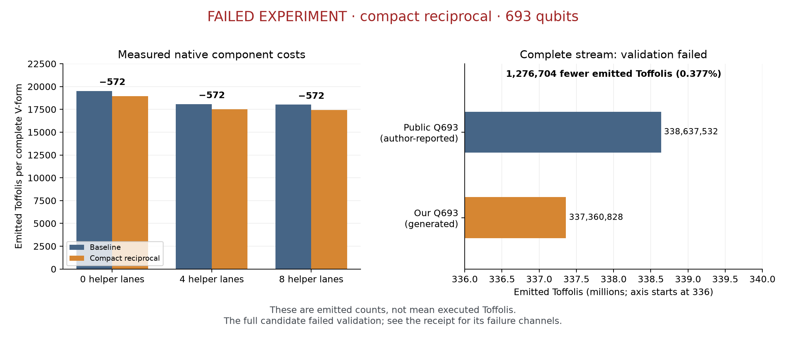

# Experiment outcomes: verified baselines and unfinished research

[Final ten-hour report and current handoff](overnight-final-report.md) supersedes dated checkpoint statuses below. No original submission-ready improvement has qualified.

Updated 15 October 2026, Singapore time. This report preserves unsuccessful
experiments and component-level findings. **No original candidate in this
repository is ready for challenge submission.** These experimental costs do not
appear in the README's performance plots or result tables.

The active10-hour cycle and its latest source-bound evidence are in
[the overnight report](overnight-20261014.md). It additionally reproduces the
public Toffoli leader `b3c9fdd6` with all9,024shots passing atQ1235/T761,156;
this is a public reproduction. N275-v2 completes all9,024shots with one failure
in each of the value, phase-batch and ancilla-batch channels. Head-selector
evaluation remains pending as of18:22UTC. N274-v4's generated stream is not
graded because the preserved shot2379 primitive counterexample blocks it.
The historical compact-reciprocal evidence below remains preserved.

## Complete passing reproduction

The public `c5bb1ec876db859a3f9f8a9052c140a145df834e` source passed the unchanged
9,024-shot benchmark at **Q1234 / mean executed T761,658 / product939,885,972**.
All three failure channels were zero. The replay took 4:03.85 and about 4.03 GiB
peak RSS. This is an existing design, not our own improvement, and its product
does not beat the latest public leader.

Evidence: [server receipt](data/server-verification.json).

## Compact reciprocal: component success, full-circuit failure

Base source: public Q693 revision `c95b9325`. Our change represents the reciprocal
remainder in 24 lanes instead of 25, storing overflow in the existing quotient
flag. It does **not** lower the full circuit's peak width, which remains Q693.

What worked:

- The restoring-division identity passed the stated solver checks.
- The comparator passed 43,688 exhaustive small-width cases and the restoring
  step passed 16,383 cases.
- Native reciprocal fixtures passed 1,536 cases and 1,089,536 independent
  measurement-phase coefficients. The focused suite passed 17 tests, with one
  existing research test ignored.
- A fixed 203-column traversal passed with 64 varied payloads and zero phase.
- Those native fixtures emitted 572 fewer Toffolis per complete V-form.

What failed:

- The initial carry-in order failed at `k=2, D=3, R=1`. That defect was repaired.
- A broad suite exceeded its 8 GiB limit; a column fixture exceeded 16 GiB before
  passing with sufficient memory. Those aborted runs are not passing results.
- The integrated candidate failed the full 9,024-shot benchmark: **6 classical
  mismatches, 3 phase-garbage batches and 6 ancilla-garbage batches**. The first
  reported classical mismatch was shot 1170. Exit status was 1; there is no valid
  score. The run took 38:17.50 and peaked at about 59.7 GiB RSS.

This chart is retained only as a diagnostic. The generated candidate contains
337,360,828 emitted Toffolis, against 338,637,532 reported by the public baseline
author. The 1,276,704 difference is **not a valid scored saving**. Emitted gates
differ from mean executed gates, and full correctness failed. The public baseline
emitted count was not independently rebuilt here. Neither count qualifies this
modified candidate for submission.

The unchanged base and modified stream produce different hash-derived test
packets. Comparing their separate default packet results cannot establish who
introduced the failure. The next diagnostic must replay the **same failing point
inputs** through both circuits, track values, scratch and phase, and find the
first divergence. Keep such diagnostics outside the submission harness. Add a
regression for the localized defect, then rebuild and run the unchanged full
benchmark on the repaired source. Do not change a nonce to obtain a passing
packet.

Evidence: [exact patch](../experiments/qubits/compact-reciprocal.patch),
[source manifest](../experiments/qubits/manifest.json),
[experiment receipt](data/qubit-experiment.json),
[detailed implementation notes](research-plan.md), and
[server operation record](SERVER_HANDOFF.md).

## Gate synthesis: useful bounds, no implemented improvement

The isolated forward/reverse correction networks passed all 78 inputs in their
specified signed domain. Their 14 and 12 AND gates match the lower bounds for
those fixed inputs and outputs. Resynthesizing those exact isolated interfaces
cannot reduce their AND counts.

The surrounding forward constructor was checked over all 16,384 raw inputs. Its
value interface has a 25-AND lower bound; the current unshed construction uses
31 forward ANDs. This motivates joint synthesis across construction and cleanup.
The six-AND gap is **not** a demonstrated saving, a guarantee of an attainable
circuit, or a complete Toffoli cost. Scratch ownership, measurement phase and
cleanup must be counted too.

Evidence: [source-bound analysis](data/fold-core-analysis.json).

## Recommended starting order for all three objectives

Start gate/product experiments on the reproduced Q1234 source, keeping that
passing baseline intact. A final mean T ≤ 761,491 improves today's product;
T ≤ 761,155 improves both global gate and product records at that width. From
the reproduced T761,658, those require reductions of at least 167 and 503
rounded mean executed Toffolis respectively. They are targets, not predictions.

In the width track, first diagnose and repair the failed reciprocal integration.
Then prove the complete quotient-owner and crossing-padding schedule before
attempting N275/Q692. A smaller reciprocal scratch allocation alone does not
lower peak circuit width. Keep this track active as a separate design rather
than expecting it to win gate and product records simultaneously.

Before reporting an original result, bind all evidence to the final source and
stream, pass the complete official benchmark, check meaningful independent cases
and compare against freshly fetched public records. Move a candidate into the
README only after it qualifies. Official product promotion and a separate
qubit/Pareto achievement must remain distinct.
