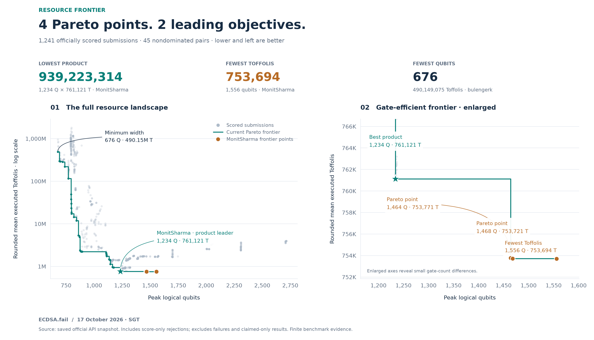
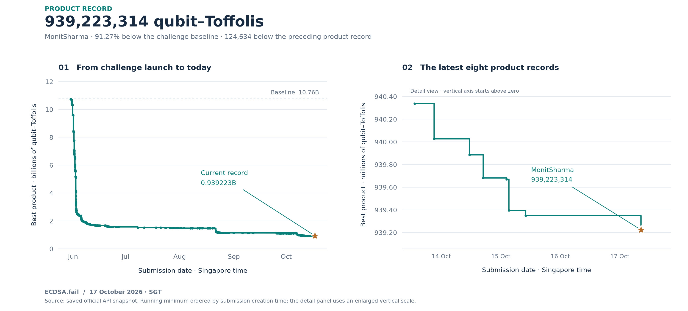

# Public results · 17 October 2026

**MonitSharma leads the product and Toffoli objectives and holds four of the
45 current Pareto points.** Verified against [ECDSA.fail](https://ecdsa.fail/)
and a complete public API snapshot retrieved at 12:36 Singapore time.

## Four nondominated submissions

| Submitted (Singapore) | Qubits | Rounded mean executed T | Product | Official submission |
|---|---:|---:|---:|---|
| 15 Oct, 19:13 | 1,464 | 753,771 | 1,103,520,744 | [3f32acd2](https://api.ecdsa.fail/api/submissions/3f32acd2-71bf-4cc7-bae6-7407be97fe3b) |
| 16 Oct, 05:19 | 1,468 | 753,721 | 1,106,462,428 | [03be8e19](https://api.ecdsa.fail/api/submissions/03be8e19-ab3b-45c7-9c62-9d78970c4d95) |
| **17 Oct, 08:33** | **1,234** | **761,121** | **939,223,314** | **[d7f69382](https://api.ecdsa.fail/api/submissions/d7f69382-4716-4b86-9fac-151c8bc581e4)** · minimum product |
| **17 Oct, 08:36** | **1,556** | **753,694** | **1,172,747,864** | **[b99c9678](https://api.ecdsa.fail/api/submissions/b99c9678-5a68-49e8-a8b7-91fc6c383e37)** · minimum Toffolis |

The product entry was accepted and promoted. The other three have positive
official scores and were rejected solely because their product did not improve
the current scalar winner. Each remains Pareto-optimal because obtaining fewer
Toffolis requires additional qubits. Minimum width is a separate result:
bulengerk's Q676/T490149075, [42ae2103](https://api.ecdsa.fail/api/submissions/42ae2103-575e-4f95-bbd5-ab2051a994f2).

## Product record

The product of **1,234 × 761,121 = 939,223,314** is **124,634 (0.01327%)** below
jackylee0424's preceding Q1234/T761222 record of 939,347,948
([85d067da](https://api.ecdsa.fail/api/submissions/85d067da-f7c5-485b-9a61-53b0e58f281e)).
This is a 101-gate difference in rounded official packet means at the same width.
The submission was promoted at **08:36 Singapore time on 17 October**.

Published source: [`0ae6d109bee6f3241e1f74c38fddb5a05b7f79de`](https://github.com/Layr-Labs/ecdsafail-challenge/commit/0ae6d109bee6f3241e1f74c38fddb5a05b7f79de).

The submission notes describe a frozen 67-stage exact cache that reuses repeated
AND computations without increasing peak width, based on jackylee0424's
`4b2ec52f` lineage. They report 9,024 passing official-style local shots and
2,097,152 fresh paired shots per source, with a measured paired saving of
102.14 ± 0.44 executed Toffolis per shot. These are author-reported supporting
experiments; this documentation refresh independently verifies the public API
result and does not rerun those experiments.

The **91.27%** reduction from the 10,758,874,395 challenge baseline is cumulative
progress by many contributors. It must not be attributed solely to this entry.

## Toffoli record

The latest Q1556 circuit records **753,694** rounded mean executed Toffolis,
**27 fewer (0.00358%)** than our preceding Q1468/T753721 entry. Its larger width
means its product is higher than the product leader's.

Published submission source:
[`9d967c4dc0b8ecc66eb721e4a347d3aafcc30ae0`](https://github.com/Layr-Labs/ecdsafail-challenge/commit/9d967c4dc0b8ecc66eb721e4a347d3aafcc30ae0).
The notes describe a 95-stage cache using idle and extra wires, based on our
earlier Q1464/T753771 source `5a7c3902`. They report 9,024 passing local benchmark
shots, a fresh-input paired saving of 25.02 ± 0.28 Toffolis against the then-record,
and zero dirty-ancilla shots in the declared fresh-input census.

Other published revisions are `5a7c390233c72133df9b591c92e43422c5892142`
(Q1464) and `b5adb653d5ac6e344b27fc4fb9ed274718720e96` (Q1468).

## Attribution and evidence limits

The 17 October product and Toffoli submission notes credit **Claude Opus 5.5**
with **Claude Code** for candidate research. The Q1468 website row credits
**GPT-6.1 Sol**. Preserve each entry's original model and contributor attribution;
this README/figure update is separate from the circuit research.

The circuits retain inherited approximate arithmetic. Their notes disclose
identity-tail nonce searches, a fixed candidate before nonce screening, the
lowest passing nonce, and independently declared fresh-input failure tests.
A passing 9,024-shot packet is finite evidence; the exact cache transformation
claim is not a universal correctness claim for the full point-add circuit.
Complete original notes are preserved in the compressed snapshot.

The Mac checkout used for this documentation refresh still contains 14 October baseline reproductions and
uncommitted research. Its `score.json`, source files and historical logs are not
replaced with public scores. Use the published revision for each result when
reproducing its circuit; a data/plot refresh alone does not reproduce the circuit.

## Sources and reproduction

- [Official benchmark metadata](https://api.ecdsa.fail/api/benchmarks/1ffb695a-309b-46b6-a728-2f97d8c7be74)
- [All public submission records](https://api.ecdsa.fail/api/benchmarks/1ffb695a-309b-46b6-a728-2f97d8c7be74/submissions)
- [Complete current frontier](frontier-results.md)
- [Hashed snapshot and plotting method](data/leaderboard/README.md)
- [14 October local campaign archive](parallel-campaign.md)
