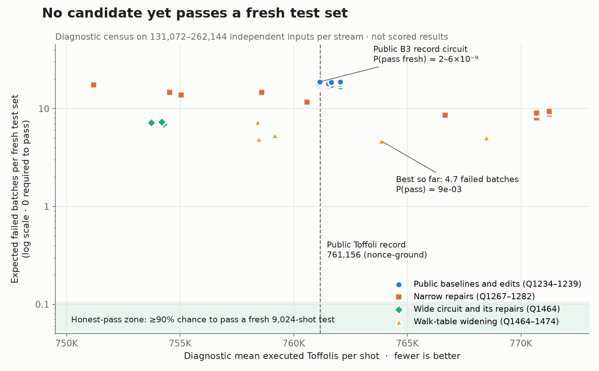

# Honest failure-rate census of the Toffoli/product research streams

Completed 15 October 2026. Diagnostic only: **no qualified score, no new
record, no packet or nonce selection.** This experiment measures how often each
existing stream fails on fresh inputs, which determines whether it can pass the
unchanged benchmark without a searched validation nonce.

## Why this matters

The evaluator derives all 9,024 test inputs and the measurement randomness from
a SHAKE256 hash of the op stream (`src/bin/eval_circuit.rs`, `fiat_shamir_seed`).
Any source change therefore receives a fresh packet. The public B3 source pins
`TAIL_NONCE = 1013008676774` and rewrites a 96-op identity tail to encode it
(`agents/toffoli/src/point_add/mod.rs`, `apply_tail_nonce`). Its walk width
schedule is documented as a fitted quantile whose change "invalidates the ground
nonce", and its truncated slices drop a borrow with probability about
2^-guard per execution. Our rules forbid nonce or packet search. A circuit we
submit must therefore pass a fresh packet on its own merits.

## Method

`census/` is a small research crate linked against the protected
`quantum_ecc` library, with its simulator, curve, and circuit files unchanged
(their hashes are recorded in `evidence/logs/tool.sha256`). It copies the
evaluator's loader, curve constants, Fiat-Shamir function and sampling rule
verbatim. Per 64-shot batch, it draws scalars from an independent labelled
SHAKE256 (`ecdsa-research-failure-census-v1`, label, batch index), applies the
evaluator's degenerate-pair skips and seeds the simulator's measurement RNG
from the same XOF. It checks the same value, phase and ancilla conditions.

**Validation control.** The crate also contains the evaluator's `run_tests`,
copied verbatim and driven by the stream's own Fiat-Shamir seed (`@official`).
On the unchanged public B3 stream (`0f10de57…`), it reproduces the scored
result exactly: 9,024 shots, zero failures, mean 761,155.566, which rounds to
**761,156**.

The evaluator fails a whole 64-shot batch on any phase or ancilla error, so the
probability of passing a fresh packet is `(1 − f)^141`, where `f` is the
measured per-batch failure fraction. Intervals are exact Clopper–Pearson 95%.

## Core result: three reference streams, 262,144 shots each

| Stream | Q | Diag. mean T | Value fails /10⁴ | Phase-only /10⁴ | Failed batches /packet | P(pass fresh packet) |
|---|---:|---:|---:|---:|---:|---:|
| Public B3 (`0f10de57`) | 1235 | 761,151 | 17.36 | 3.40 | 17.73 | **5.9×10⁻⁹** (1.1×10⁻⁹–2.9×10⁻⁸) |
| Narrow repaired control (`b26a283a`) | 1282 | 770,689 | 8.13 | 3.40 | 10.05 | 3.0×10⁻⁵ |
| Wide cap1536 (`95e771ba`) | 1464 | 753,725 | 7.10 | 0.65 | 6.78 | 9.6×10⁻⁴ (3.4×10⁻⁴–2.4×10⁻³) |

All three streams have **zero ancilla failures** in all shots.

The diagnostic mean T values agree with each stream's own official-packet replay
(B3 761,155.6; control 770,684.2; wide 753,722.6). On their own Fiat-Shamir
packets, the control fails with 3 value mismatches and 5 phase batches; the wide
stream fails with 6 value mismatches and 2 phase batches.

Diagnostic figure, **not scored results** (`plot_honest.py`; PNG and SVG in
`figures/`). It shows all censused streams plus the
[walk-widening variants](../widen-walk-20261015/STATUS.md). The shaded band is
where a stream would pass a fresh 9,024-shot test with at least 90% probability.

## Failure families (replay under 32 measurement seeds)

| Stream | Inputs | Deterministic wrong value | Seed-dependent phase only |
|---|---:|---:|---:|
| B3 | 544 | 455 | 89 |
| Control | 302 | 213 | 89 |
| Wide | 203 | 186 | 17 |

- **Value failures are deterministic arithmetic errors.** Every wrong value
  recurs under all 32 independent measurement seeds. Most outputs are fully
  garbled: both coordinates are wrong, the modular difference exceeds 2²⁰⁰, and
  about 120 bits differ. This indicates an early truncation or overflow that
  propagates, not a late carry slip. Most of these inputs also produce phase
  failures as a consequence.
- **Phase-only failures depend on measurement outcomes** and occur with an
  unchanged value. In the wide stream they account for under 10% of failed
  batches (about 0.6 expected per packet), versus about 6.4 from value failures.
- No value-only failure involved a ±p wraparound.

The protected instruction set offers only X-basis measurements (`Hmr`, `R`)
with random outcomes. There is no data-dependent readout, so classically
conditioned blocks cannot implement a cheap rare-event repair. The cost of
correctness must be paid unconditionally in executed Toffolis.

## All streams built on 15 October

We censused all 28 distinct candidate streams from today's experiments plus the
C5 reference, 262,144 shots each. **None has better than about 10⁻³ odds of
passing a fresh packet.** The best is the other agent's newest wide variant
(`joint-carry/state3`, 6.9 failed batches per packet).

- Rail headroom and extra walk rounds lower the value-failure rate from about
  17 to about 6.6–7.5 per 10⁴, then it plateaus. For example, `margin3` is 10.8
  and `margin3-tail2` is 6.9.
- The newest phase-repair streams (`y15-unseeded`, `joint-carry/state3`) leave
  the rate unchanged within noise. They target the minor phase-only family.
- The scratch-only cap1267 stream reaches **T 751,197** but fails about 17.5
  batches per packet.
- The public C5 product baseline (Q1234) has P(pass) ≈ 1.5×10⁻⁸, the same
  regime as B3.

[Full table](all-streams.md).

## Implications for the Toffoli and product objectives

1. **The public T and product baselines are not honestly passing designs.**
   B3 and C5 each have roughly a 10⁻⁸ chance to pass a fresh packet. A
   submission built on them without a nonce search needs about a 100× lower
   failure rate, not merely individual counterexample repairs.
2. **Phase-witness repairs alone cannot qualify the wide candidate.** Value
   failures dominate. Even perfect phase repair leaves P(pass) ≈ 2×10⁻³.
3. **The wide candidate has a 7.4K Toffoli budget below the record**
   (753.7K vs. 761,156). The [guard-bit sweep](../guard-sweep-20261015/STATUS.md)
   shows that the named guard and compare knobs cannot spend it on honesty.
   An exact gate-inert trace then located 84% of value failures in the
   leapfrog walk rails, whose envelope was fitted with an explicit
   0.077%-per-walk drop budget. See the
   [value-failure trace](../trace-value-20261015/STATUS.md).
4. **Gate every future candidate with this census** (about one minute for
   262,144 shots at 16 threads). An expected-failed-batches value well below
   0.1 per packet is needed before a full benchmark run is worthwhile.

## Reproduction and provenance

Server directory `/home/hclau/ecdsa_research/failure-census-20261015/`.
`run.sh` ran the three reference streams (PID 3156126, all exit 0) and
`run-replay.sh` ran the seed replays (PID 3161513, exit 0).
`run-all.sh` censused every stream (PID 3163097; 29 runs, all exit 0). Results, logs, stream hashes,
tool hashes and the inputs that failed are under `evidence/`. Rebuild with
`cargo build --release --offline` in `census/` or `replay/`. Run
`python -X utf8 analyze.py` / `table.py` to regenerate the tables.
Total use was 16 threads and under 1 GB RSS per process; no other workload was
touched.
