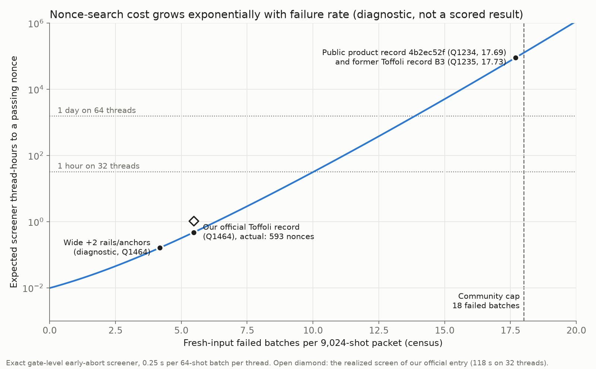

# Product record on the public tip (4b2ec52f): feasibility measured, stopped

15 October 2026. **No candidate, no score.** This experiment measured whether
the Q × T record (939,347,948 = 761,222 T × 1,234 Q; jackylee0424,
submission 85d067da, source `4b2ec52f`) can be beaten under the
disclosed-failure-rate standard. With the savings we have today it cannot be
done in reasonable time. The work stopped before any long search.

## Measurements

The tip was built from `4b2ec52f`, an unmodified public source whose protected
files match B3. Its stream has SHA-256 `2a522394…` and 11,630,716 ops.

| Quantity | Value | Source |
|---|---:|---|
| Official replay at its own nonce 1,046,072,871,510 | pass, **761,221.981383** T | `evidence/tip-official.txt` (equals the official score) |
| Fresh-input failure rate (262,144 shots) | **17.69** failed batches per packet | `evidence/tip-census.jsonl.gz` |
| Fresh-input mean T | 761,221.70 | same census |
| Packet-to-packet SD of mean T | **6.2** T | batch-mean SD 73.5 / √141 |
| Screener cost per failing nonce | **2.1 s** per thread (8.4 batches × 0.25 s) | 256 nonces, none pass |
| P(pass) per nonce | (1 − 514/4,096)^141 ≈ **6×10⁻⁹** | census batch-failure fraction |
| Expected nonces to a pass | ≈ **1.6×10⁸** | 1 / P(pass) |
| Brute-force screen | ≈ **90,000 thread-hours**, about **58 days on 64 threads** | `figures/search-cost.png` |

(An earlier draft used the Poisson shortcut e^−λ and quoted 4.8×10⁷ nonces and
18 days. With 12.5% of batches failing, the exact binomial (1 − f)^141 is the
right model and is three times more expensive.)

**Product threshold.** A record needs rounded T ≤ 761,221 at Q1234, so the
packet mean must be below 761,221.5. The tip's fresh mean is 761,221.70, so an
unmodified re-roll has only about a 49% chance of clearing. Exact savings must
also cover about 2 SD (≈12 T) for a reliable clearance. The lowest-pass nonce
policy does not choose packets by T.

## Width-free cache rewrite on the tip

The external `product_paired_diagnostic` analyzer (from
[cache-idle-20261015](../cache-idle-20261015/STATUS.md), atom cap 32 and
product cap 200,000) was applied to the tip stream. It keeps the width at
**1,234** and places 2,518 cache windows, with a static proxy of 522.2 against
575.5 on B3.

A paired census with the same label and therefore the same 262,144 inputs
(`evidence/cache/`) gives:

- saving of **2.18 ± 1.24 T per shot** (standard error; per-batch differences
  are noisy because measurement-dependent cleanup diverges);
- failure rate 17.66 against 17.69, unchanged; 4,047 of 4,096 batches have
  the same pass/fail outcome.

So the cache alone would move the expected mean to about 761,219.5. That gives
about a 60–65% chance of clearing on the selected packet, and it still needs
the 1.6×10⁸-nonce search. It has not been ported into `src/point_add`.

## Why the product record is blocked

1. **Search cost.** At the record's failure rate, our exact gate-level
   screener needs about 58 days on 64 threads. Competitors report GPU or
   classical prefilters (for example, the 860 entry's CUDA prefilter and
   BitWonka's first-failing-batch predictor). The tip source contains none.
2. **No T budget to buy back failure rate.** Every known failure-rate
   reduction costs T. Tail smoothing costs +37 T for about −1.4 batches on the
   wide circuit, and at Q1234 it may also cost width. The only exact
   width-free saving measured is about 2 T. Census-style rare-event cuts would
   save T but trade correctness, which our standard excludes.

## Search cost versus failure rate

Diagnostic figure (`plot_search_cost.py`; PNG and SVG in `figures/`), not a
scored result. The curve uses the measured 0.25 s per 64-shot batch per thread
and the exact binomial pass probability. Useful thresholds for planning:

| Failure rate (failed batches per packet) | Expected screen with the exact screener |
|---:|---|
| ≤ 5.5 | under 1 thread-hour (our official entry: 593 nonces, 118 s on 32 threads) |
| ≤ 10.0 | under 1 hour on 32 threads |
| ≤ 13.85 | under 1 day on 64 threads |
| 17.7 (product record) | about 58 days on 64 threads |

So with no faster screener, a product candidate must first be brought down to
about 14 failed batches or less. Each batch removed cuts the search by about e×.

## What would unblock it

- **A classical value-failure prefilter.** About 80% of tip failures are
  wrong values (431 of 541 failing shots). On the traced wide circuit these
  were deterministic and mostly walk-rail overflow; the tip has not been
  traced. A classical replay of the leapfrog walk with the circuit's rail
  envelope, plus a fast secp256k1 scalar multiplication, could reject most
  failing nonces in microseconds. Gate simulation would then run only on the
  survivors (roughly 30–40 nonces at the remaining phase/other rate).
  Estimated effort is several days, and it benefits every future search.
- **New exact zero-width savings of ≥ 12–15 T** on the tip, or failure-rate
  repairs cheaper than about 5 T per batch.

## Files

`run-tip.sh` is the server launcher. `plot_search_cost.py` makes the figure.
`evidence/` holds the official replay,
census, screener timing, stream hashes and the cache summary and paired census.
Server directory: `/home/hclau/ecdsa_research/product-tip-20261015/` (`tip/` is
a detached worktree of `4b2ec52f`).
